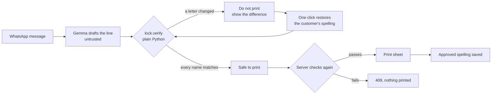
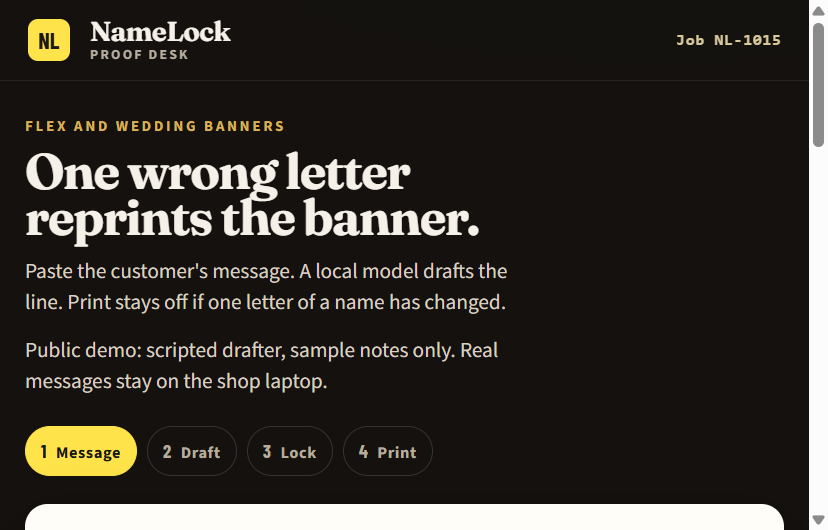
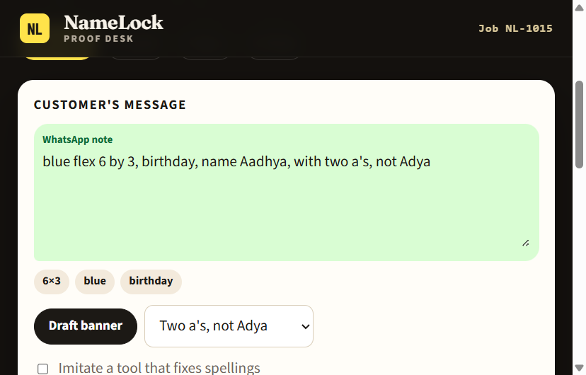
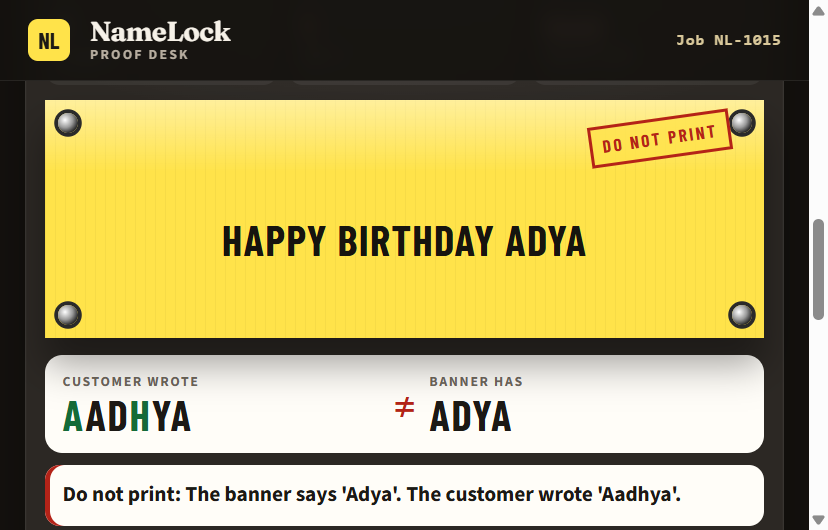
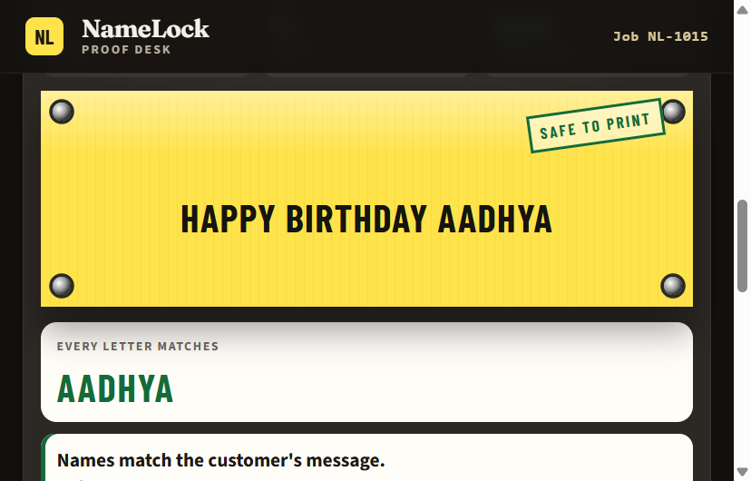
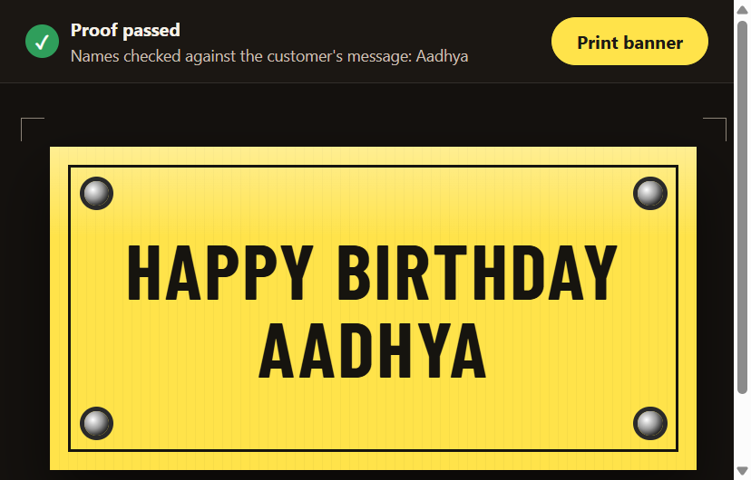

# NameLock

*This is a submission for the [Hacktoberfest Open-Source AI Challenge Week 2: Side Hustle](https://dev.to/challenges/hacktoberfest-week2-2026-10-12)*

One wrong letter in a name means a banner gets thrown away and printed again. NameLock lets a local
open-weight model draft the banner line, then refuses to print if any name is not exactly as the customer wrote it.

## What I Built

A flex-banner and wedding-card print shop gets orders as messy WhatsApp messages:

> blue flex 6 by 3, birthday, name Aadhya, with two a's, not Adya

NameLock reads the message and drafts the banner (`Happy Birthday Aadhya`). Then a plain Python check
compares every name on the banner to the customer's own words. If a letter changed, the page stamps
**Do not print**, shows the customer's spelling next to the banner's spelling, and keeps the print button off.
One click puts the customer's spelling back, the stamp turns **Safe to print**, and the button turns on.

The shop is the customer. A reprint costs a banner, so a wrong name is a real cost to the owner. I have not
sold this to anyone yet, and I did not invent a shop or a price. The tool is built for a person who runs
that counter every day.

What the check does, in order:

1. Blocks a spelling the customer rejected ("not Adya").
2. Blocks a name that is not in the customer's message.
3. Blocks a name that is missing from the banner. If the banner has a near miss (Adya for Aadhya), it says
   which word and offers the repair.
4. Asks for a confirmation, not a silent merge, when a name is close to a spelling the shop approved before.

Accents count: José is not Jose. The model may arrange the line. It may not change a name.

### Step by step



**1. The desk.** The shop opens one page. The header says what the tool is for: one wrong letter reprints
the banner. The four steps along the top (Message, Draft, Lock, Print) show where the job is.



**2. The customer's message.** The shop pastes the WhatsApp text as it came, or picks a sample. The page
pulls out the size, colour and occasion as small tags so the shop can see what it understood.
On the real laptop, Gemma reads this message. In the demo, a scripted drafter does.



**3. The lock stops a changed name.** The drafted line is `Happy Birthday Adya`, but the customer wrote Aadhya.
This is the failure a chat tool that "fixes" spellings causes. The banner gets a red **Do not print**
stamp, the customer's spelling is set against the banner's spelling letter by letter, and the print button stays off.



**4. One click puts the name back.** **Use the customer's spelling on the banner** restores Aadhya. The lock
runs again on the repaired text, and the repair is only offered if that text passes. The stamp turns
**Safe to print** and the print button turns on.



**5. The print sheet.** The sheet shows **Proof passed** and the names that were checked. The banner text
shrinks to fit the sheet, and the controls are hidden when you print, so only the yellow banner is on paper.
Before it returns this page, the server runs the lock a second time, so posting a changed name straight to
`/api/print` still gets a 409.



**6. The shop remembers.** When a banner prints, its names are saved as approved spellings. The next time
a message has a name close to an approved one but not the same (Priyanca after Priyanka), the page does not
merge them silently. It asks the shop to confirm that it is a different person.

## Demo

<!-- Fill in once Render is deployed: the sample link, and optionally a screen recording. -->

The public demo is `render.yaml`, which runs on Render in sample mode. It has no model on the server. A small scripted drafter
builds the line from the note, and a checkbox, **Imitate a tool that fixes spellings**, makes it rewrite the
name on purpose so you can watch the lock stop it. It is labelled as scripted on the page. The in-memory
spelling book is not saved, and nothing you type is stored.

The real model runs on the shop laptop. That is by design (see below), so a public page cannot call it.

## Code

Repo: <https://github.com/abhishekmsm51w-star/namelock> (MIT).

```text
namelock/lock.py      the spelling check. No model. This is the only gate to the print button.
namelock/drafter.py   Gemma through Ollama, plus a scripted drafter for the demo and tests
namelock/app.py       FastAPI. The server re-checks before it returns a print page
namelock/book.py      approved spellings: SQLite, or Postgres (Tiger Cloud) with DATABASE_URL
namelock/cases.py     20 tricky names used by the benchmark
bench.py              runs the 20 names and exits non-zero if a changed name could print
```

Run it on your own machine:

```bash
pip install -r requirements.txt
ollama pull gemma3:1b            # model name is set by NAMELOCK_MODEL
uvicorn namelock.app:app --port 8000
```

Sample mode, no model: `NAMELOCK_BACKEND=demo`. `render.yaml` deploys that mode.
For the Tiger book, `pip install -r requirements-tiger.txt` and set `DATABASE_URL` in a `.env` file
(it is in `.gitignore`).

Tests:

```bash
pip install -r requirements-dev.txt
python -m pytest -q
python bench.py --backend scripted-autocorrect   # SIMULATED tool that "fixes" 20 names
python bench.py --backend ollama                 # the real model, once Ollama is running
```

## How I Built It

**Gemma, locally.** The drafter asks `gemma3:1b` through Ollama for JSON: names copied exactly as typed,
the occasion, the size, the colour and the banner line. The prompt tells it never to respell a name. I do not
trust that. The model is untrusted by design, and whatever it returns goes through `lock.verify()`.

**The lock is plain Python.** No model is involved in the decision. It normalises Unicode (NFC) and keeps
accents significant, treats a possessive 's as not part of the name, and compares case-insensitively so an
all-caps banner still matches. A suggested repair is only offered if the repaired text itself passes the same check.

**The server does not trust the browser.** `/api/print` runs the check again. If someone bypasses the page and
posts a banner with Adya, it answers 409 and returns no print page. A test covers this.

**Tiger Data for approved spellings.** When a banner prints, the names on it go into a small Postgres table
(`approved_names`) on Tiger Cloud. Next time a message has a name that is close to, but not the same as, an
approved one, the lock asks the shop to confirm it is a different person. Only confirmed spellings are stored.
Customer messages are never written to the database. This is a plain table. It is not pgvector or hybrid search,
and I am not claiming either.

**The page.** A proof desk, not a form: the customer's message on a ticket on the left, a yellow flex banner on
the right with grommets and a stamp, and the customer's spelling set against the banner's spelling when they differ.
The print page is a yellow sheet that fits the text to the banner and hides the controls when you print.

**Results, stated plainly.**

- 105 tests pass. Breaking the "name missing from banner" check on purpose made 26 of them fail, so the tests do not pass by accident.
- Real Gemma run on 2026-10-15, `gemma3:1b` on my PC, 20 invented tricky names (Aadhya, Siobhan, José, D'souza, Mary-Anne and others):
  the model dropped 2 names from the banner (Siobhan, Mary-Anne). The lock caught both. 0 leaked, 0 false alarms.
  Median draft 0.4 s. The first call took 61 s while the model loaded.
- That run did not respell any name. The "tool that fixes spellings" behaviour in the demo is a simulation
  I wrote, and the `scripted-autocorrect` benchmark (20 of 20 caught) tests the lock against that simulation. It is not a
  measurement of Gemma.

**Where data goes.**

| Path | Customer message | Names | 
| --- | --- | --- |
| Shop laptop, Ollama | Stays on the laptop. The model runs at `127.0.0.1:11434`. | Approved spellings in local SQLite, or in Tiger Cloud if `DATABASE_URL` is set. Only names, no messages. |
| Public demo on Render | Sample notes only. The text you type goes to the Render server and is not stored. | In memory, lost on restart. |

The page loads fonts from Google Fonts, so the browser contacts Google on every path.

**Not done yet.** The 20 names in `cases.py` are invented. They are not a real shop's customers. The tool
has no first user. The demo cannot show Gemma, only the scripted drafter.

## Why Does Open Innovation Matter?

Three things a closed chat tool would not give this shop.

The messages stay on the counter. They hold names and phone numbers. With a local model they never leave the laptop.

There is no fee per banner. The shop prints many small jobs, and a per-call price is a poor fit.

The shop can fix the behaviour, not just hope for it. The bug here is a hosted chat tool that "corrects" a
spelling. With an open model I can pin the instructions, swap the model, and put a check that does not
depend on the model after it. The lock does not care which model drafted the line, so a better or smaller
model can replace Gemma without touching the part that matters.

## Prize Categories

- **Best Use of Gemma.** Gemma (`gemma3:1b`) drafts every banner in the real path, locally through Ollama.
- **Best Use of Tiger Data.** A Tiger Cloud Postgres service holds the shop's approved spellings, and the lock
  uses it to ask for confirmation. This is a plain table, not vector search.
- **Best Use of Render.** `render.yaml` deploys the sample demo front end to Render. The model stays local on purpose.
  <!-- Keep this only after the Render link in Demo is live. -->
- **Best Use of GitHub Actions.** `.github/workflows/test.yml` runs the tests and the 20-name benchmark on every push.
  The build fails if a changed name could still print.
  <!-- Best Use of .tech Domain: add a line here only after the domain points at the demo. -->

Challenge closes 2026-10-18 11:59 PM PDT. Tags: `#devchallenge` `#hf26challenge`.

## License

MIT
